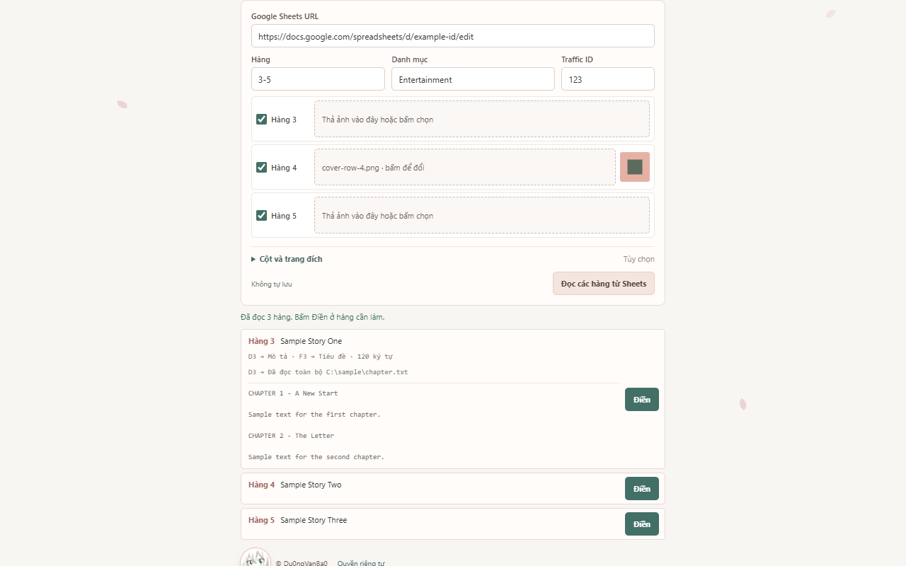
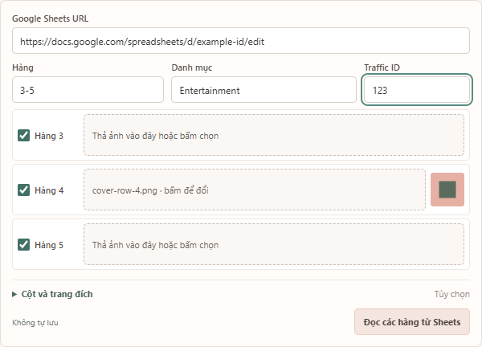
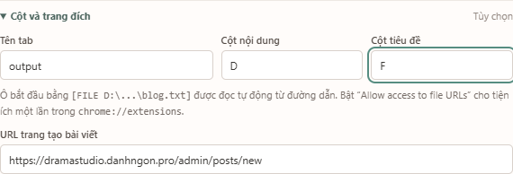
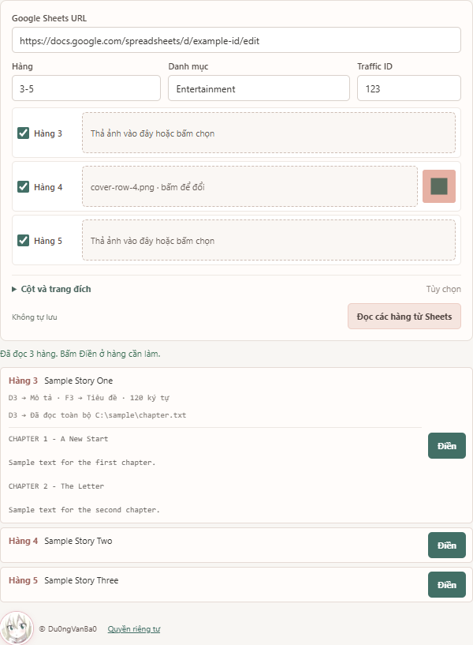

# Auto Fill Blog

Tiện ích Chrome đọc các hàng bạn chọn trong Google Sheets. Mỗi hàng có nút **Điền** riêng: bấm nút sẽ mở một tab DramaStudio và điền bài của hàng đó. Tiện ích **không bấm Lưu**; bạn kiểm tra rồi tự lưu trên website.

## Cài miễn phí từ GitHub

1. Mở [Release mới nhất](https://github.com/Du0ngVanBa0/auto-fill-blog/releases/latest), tải file `auto-fill-blog-1.3.6.zip` trong **Assets**, rồi giải nén vào một thư mục cố định. Chọn thư mục có file `manifest.json` ngay bên trong. Nếu muốn dùng mã nguồn mới nhất trên `main`, có thể tải [ZIP mã nguồn](https://github.com/Du0ngVanBa0/auto-fill-blog/archive/refs/heads/main.zip) thay thế.
2. Mở `chrome://extensions` trong Chrome trên máy tính.
3. Bật **Developer mode** ở góc trên bên phải → bấm **Load unpacked** → chọn thư mục đã giải nén ở bước 1, nơi có `manifest.json`.
4. Bấm biểu tượng mảnh ghép trên thanh công cụ, ghim **Auto Fill Blog** nếu muốn, rồi bấm icon tiện ích để mở trang cấu hình.

Đây là cách cài trực tiếp từ GitHub, chưa có bản Chrome Web Store. Giữ thư mục đã giải nén ở nguyên vị trí để Chrome tiếp tục tải tiện ích.

**Cập nhật:** tải ZIP ở [Release mới nhất](https://github.com/Du0ngVanBa0/auto-fill-blog/releases/latest), thay nội dung **trong cùng thư mục đã cài**, mở `chrome://extensions` và bấm **Reload** trên card Auto Fill Blog. Đóng trang cấu hình cũ rồi mở lại. Nếu dùng `git clone`, chạy `git pull` trong thư mục đó rồi Reload.

## Chuẩn bị

- Đăng nhập [DramaStudio](https://dramastudio.danhngon.pro/admin/posts/new) trong Chrome.
- Đặt quyền xem Google Sheets thành **Bất kỳ ai có đường liên kết đều có thể xem**. Tiện ích đọc CSV của Sheets; không cần nhập API key.
- Xác định cột chứa **nội dung blog** và cột chứa **tiêu đề**. Ví dụ ảnh bên dưới dùng cột D và F.

## Điền từng hàng

1. Dán **Google Sheets URL**. Nhập **Hàng**, ví dụ `3-5` hoặc `2,4-6`. Mỗi hàng xuất hiện ngay cùng checkbox và vùng thả ảnh đại diện riêng. Thả một ảnh vào đúng hàng, hoặc bấm vùng đó để chọn file; bỏ check hàng không muốn đọc. Tối đa 50 hàng mỗi lần.

   

2. Mở **Cột và trang đích**. Nhập đúng **Tên tab** trong Sheets, **Cột nội dung** và **Cột tiêu đề**. URL DramaStudio đã được điền sẵn. **Danh mục** mặc định là `Entertainment`; nhập **Traffic ID** để thêm số đó vào cuối tiêu đề bài và từng tên chương.

   

3. Bấm **Đọc các hàng từ Sheets** và xem trước từng hàng. Mỗi hàng có nút **Điền** riêng. Bấm nút ở hàng cần làm, chờ tab DramaStudio mở và biểu mẫu xuất hiện. Tiện ích chọn chế độ **Chương**, chọn danh mục, đưa nội dung vào mô tả, bật **Lưu tên chapter**, bấm **Phân tích chương**, rồi điền tiêu đề, Traffic ID và ảnh đại diện của hàng đó.

   

4. Kiểm tra tiêu đề, tên chương, nội dung và ảnh trên tab mới. Chỉ bấm **Lưu** trên DramaStudio khi bạn hài lòng. Muốn làm hàng khác, quay lại trang tiện ích và bấm **Điền** của hàng đó.

DramaStudio có thể tải trang danh sách bài viết trước rồi mới chuyển đến trang tạo bài qua SPA. Tiện ích chờ biểu mẫu thực sự xuất hiện, không đặt giới hạn thời gian và không tự mở thêm tab. Trong lúc chờ, giữ trang tiện ích mở; đóng tab DramaStudio để dừng lượt điền. Trạng thái mỗi hàng ghi riêng thời gian mở trang và thời gian điền.

### Nội dung dài nằm trong file local

Khi ô Sheets quá ngắn, đặt marker này **ở đầu ô nội dung**, với đường dẫn thật của file trên máy:

~~~text
[FILE C:\sample\chapter.txt]
Đoạn xem trước trong Sheets có thể bị cắt
~~~

Tiện ích nhận ra marker và đọc toàn bộ file `.txt` hoặc `.md` cho đúng hàng đó. Mỗi hàng có thể dùng đường dẫn khác nhau; không phải nhập lại file trong giao diện. Giới hạn 10 MB mỗi file.

Lần đầu dùng file local, mở `chrome://extensions` → **Details** của Auto Fill Blog → bật **Allow access to file URLs**. Quay lại trang tiện ích và bấm **Đọc các hàng từ Sheets**. Không cần quyền này khi mọi nội dung nằm trong Sheets.

### Ảnh đại diện riêng cho từng hàng

Mỗi hàng có vùng thả/chọn ảnh riêng như hình bước 1. Ví dụ ảnh chọn ở **Hàng 4** chỉ đi vào ô ảnh đại diện của bài hàng 4; không gắn ảnh vào các chương của hàng khác. Ảnh là tùy chọn, tối đa 10 MB mỗi ảnh. Chrome không giữ lựa chọn file sau khi đóng trang tiện ích, nên hãy chọn lại trước lượt điền sau.

## Khi gặp lỗi

- **Không đọc được Sheets:** kiểm tra URL, tên tab, cột và quyền xem bằng liên kết; Sheets phải cho phép đọc CSV.
- **File local không đọc được:** kiểm tra marker, đường dẫn, đuôi `.txt`/`.md` và quyền **Allow access to file URLs**.
- **Ảnh sai bài:** xem lại vùng ảnh của đúng hàng trước khi bấm Điền.
- **Chrome đang khóa thanh tab:** thả tab đang kéo, chờ một chút rồi thử lại.
- **Trang DramaStudio đổi giao diện:** tiện ích dừng ở bước gặp lỗi. Các ô đã điền trước đó vẫn ở tab để bạn kiểm tra.

## Dữ liệu và quyền truy cập

Tiện ích truy cập Google Sheets, các file local được hàng đã chọn chỉ định và `dramastudio.danhngon.pro`. Cấu hình được lưu cục bộ trong Chrome; nội dung bài và ảnh được xử lý trong phiên làm việc. Không có máy chủ của nhà phát triển hoặc chức năng tự đăng bài. Xem [chính sách quyền riêng tư](https://du0ngvanba0.github.io/auto-fill-blog-privacy/).

## Mã nguồn và kiểm thử

Thư mục gốc là mã tiện ích. `store/package.py` tạo ZIP chứa đúng các file cần cho tiện ích. `node test.js` kiểm tra xử lý Sheets; `node test.js <đường-dẫn-module-playwright>` chạy thêm kiểm thử điền biểu mẫu. `node mode-race.test.js <đường-dẫn-module-playwright>` kiểm tra trang tự chuyển Chương về Normal trong lúc tải. © Du0ngVanBa0.
